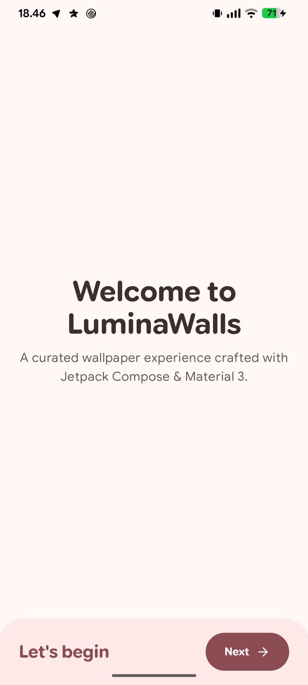
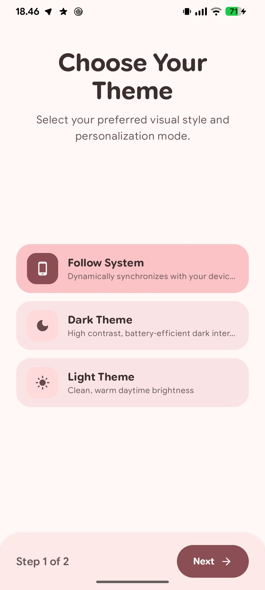
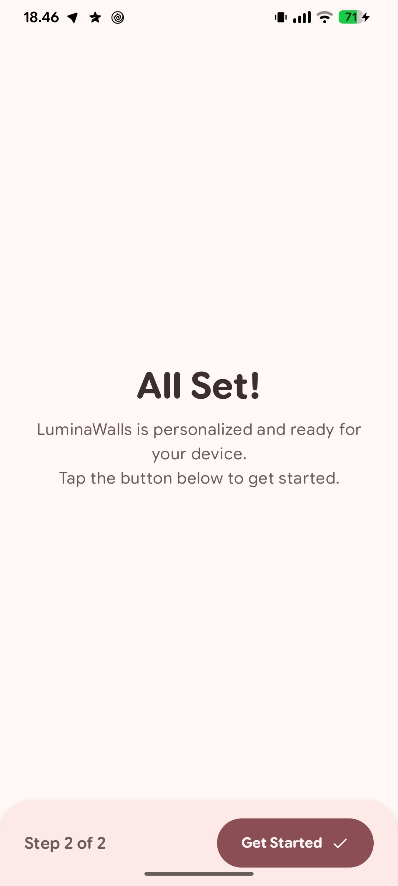
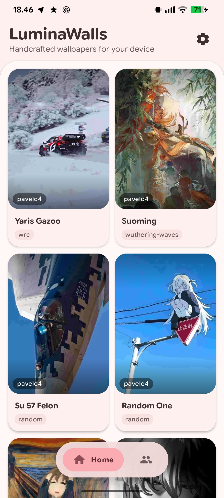
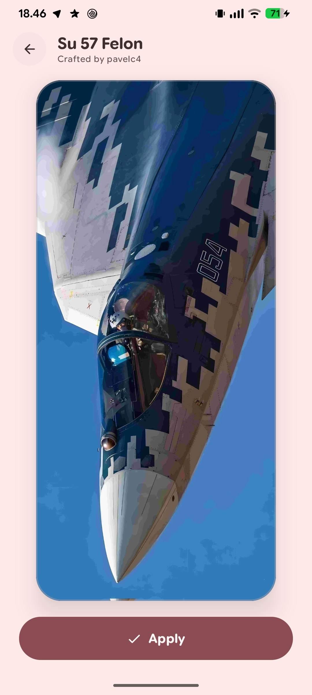
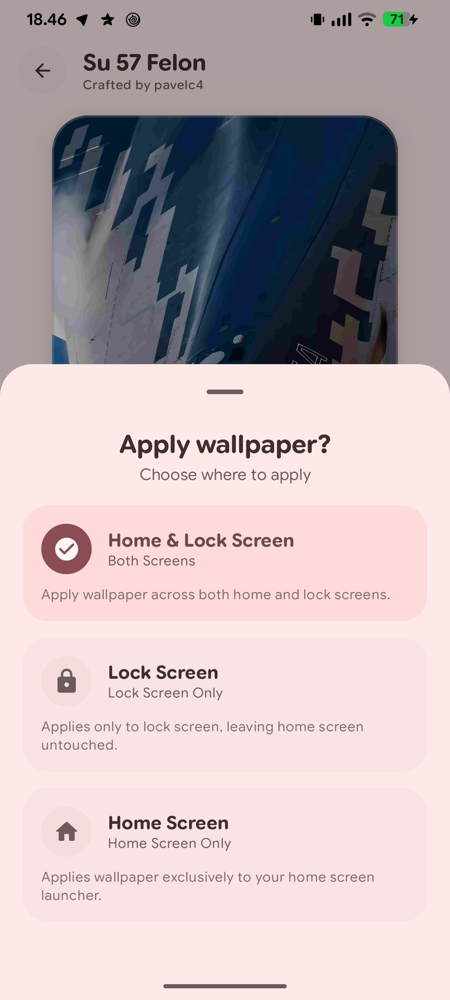
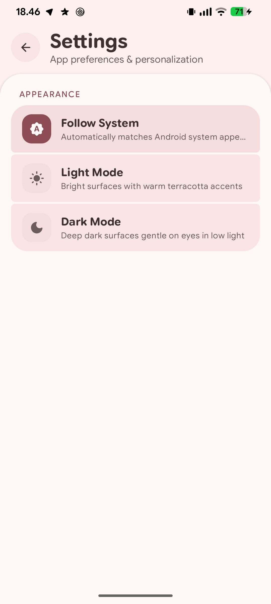
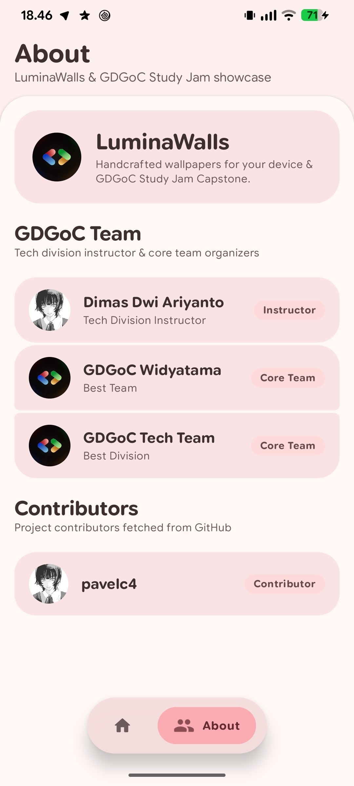

<p align="center">
  
  
  
  <a href="https://github.com/gdgocwidyatama/MobileDev"></a>
  <a href="LICENSE"></a>
</p>

# LuminaWalls - Starter Template Peserta

**LuminaWalls** adalah proyek aplikasi wallpaper Android modern berbasis **Jetpack Compose** dan **Material 3 Design**, yang dirancang khusus sebagai materi pembelajaran hands-on **Google Developer Group (GDG) On Campus Widyatama University**.

Template ini menyediakan kerangka awal (*starter template*) dengan prinsip *true blank canvas*: peserta dipandu merakit aplikasi dari nol, memahami arsitektur deklaratif, memasang dependensi secara inkremental, hingga merilis file APK produksi.

> [!NOTE]
> **Starter Template Study Jam**: Repositori ini berisi cabang kerja (*branch*) modular dari Sesi 1 sampai Sesi 5. Kamu dapat menggunakan repositori ini untuk mengikuti jalannya workshop atau sebagai batu loncatan membangun proyek Capstone portofolio kamu.

---

## Fitur Utama Aplikasi

- **Modern Jetpack Compose UI**: Dibangun 100% menggunakan Compose deklaratif tanpa XML View konvensional.
- **Edge-to-Edge Experience**: Memanfaatkan `enableEdgeToEdge()` untuk tampilan penuh yang menyatu mulus dengan status bar dan navigation bar sistem.
- **Material 3 & Monet Theming**: Mendukung Dynamic Color Android 12+, tipografi semantik, serta mode Gelap, Terang, dan Otomatis Sistem.
- **Onboarding Setup Wizard**: Layar pengenalan 3 langkah interaktif dengan animasi perpindahan mulus.
- **2-Column Stacking Card Gallery**: Galeri wallpaper dinamis dengan efek Scrim Gradient, chip kategori, dan kartu konten adaptif.
- **Preferences Persistence**: Penyimpanan data lokal pengaturan tema dan status onboarding menggunakan **Jetpack DataStore Preferences**.
- **Floating Navigation Bar**: Navigasi bawah melayang yang modern dengan animasi seleksi tab.
- **Native Wallpaper Manager**: Pasang wallpaper langsung ke Layar Utama (*Home Screen*), Layar Kunci (*Lock Screen*), atau keduanya via BottomSheet.
- **Remote API & Asynchronous Image Loading**: Integrasi REST API Cloudflare Worker dan caching gambar berkecepatan tinggi dengan Coil.
- **Production-Ready R8 Build**: Konfigurasi optimasi kompilasi APK rilis dengan ProGuard/R8 code shrinking dan resource shrinking.

---

## Pratinjau Layar Aplikasi

| Setup Wizard (Langkah 1) | Pilih Tema Monet (Langkah 2) | Setup Selesai (Langkah 3) |
| :---: | :---: | :---: |
|  |  |  |

| Galeri Utama (Home) | Pratinjau Wallpaper | Pasang Wallpaper (Dialog) |
| :---: | :---: | :---: |
|  |  |  |

| Pengaturan Aplikasi (Settings) | Tim GDGoC & Kontributor (About) |
| :---: | :---: |
|  |  |

---

## Persyaratan Lingkungan Pengembangan

Sebelum mulai, pastikan perangkat laptop kamu telah terpasang perlengkapan berikut:

- **Android Studio**: Android Studio Ladybug (2024.2+) atau versi lebih baru.
- **JDK**: Java Development Kit 17 atau 21.
- **Android SDK**:
  - `compileSdk`: 36
  - `targetSdk`: 36
  - `minSdk`: 26 (Android 8.0 Oreo ke atas)
- **Device Uji**: Smartphone Android fisik (sangat disarankan) atau Android Emulator dengan API level 26+.

---

## Cara Memulai (Quick Start)

### 1. Fork & Clone Repositori

Fork repositori ini ke akun GitHub pribadimu, lalu clone ke komputer lokal:

```bash
git clone https://github.com/<username-kamu>/MobileDev.git
cd MobileDev
```

### 2. Buka di Android Studio

1. Buka **Android Studio**.
2. Pilih menu **Open** dan arahkan ke folder proyek `MobileDev`.
3. Tunggu proses **Gradle Sync** selesai secara otomatis.

### 3. Hubungkan HP Fisik & Jalankan Aplikasi

1. Aktifkan **Developer Options** dan **USB Debugging** pada smartphone Android kamu.
2. Sambungkan smartphone ke laptop via kabel data atau Wireless Debugging.
3. Pastikan perangkat terdeteksi di toolbar atas Android Studio.
4. Klik tombol hijau **Run 'app'** (`Shift + F10`).

---

## Pengumpulan Capstone Project (Submission)

Setelah menyelesaikan seluruh sesi dan mempersonalisasi aplikasimu:

1. Pastikan seluruh commit terakhir sudah kamu push ke branch `main` repositori fork pribadimu.
2. Kunjungi repositori portal pengumpulan: **[MobileDev](https://github.com/gdgocwidyatama/MobileDev)**.
3. Buka **Pull Request** sesuai instruksi pada [Panduan Pengumpulan Capstone](https://github.com/gdgocwidyatama/MobileDev/blob/main/doc/SUBMISSION_GUIDE.md).
4. Masukkan URL submodule proyekmu dan lengkapi format formulir PR.

---

## Kredit & Pengajar

- **Instruktur & Pengembang**: [Dimas Dwi Ariyanto](https://github.com/pavelc4) - *Tech Team Mobile Development*
- **Penyelenggara**: [Google Developer Group (GDG) On Campus Widyatama University](https://github.com/gdgocwidyatama)

---

## Lisensi

Proyek starter template ini didistribusikan di bawah lisensi terbuka [MIT License](LICENSE). Kamu bebas memodifikasi dan mengembangkan kode ini untuk keperluan Pribadi Atau Komersial.
